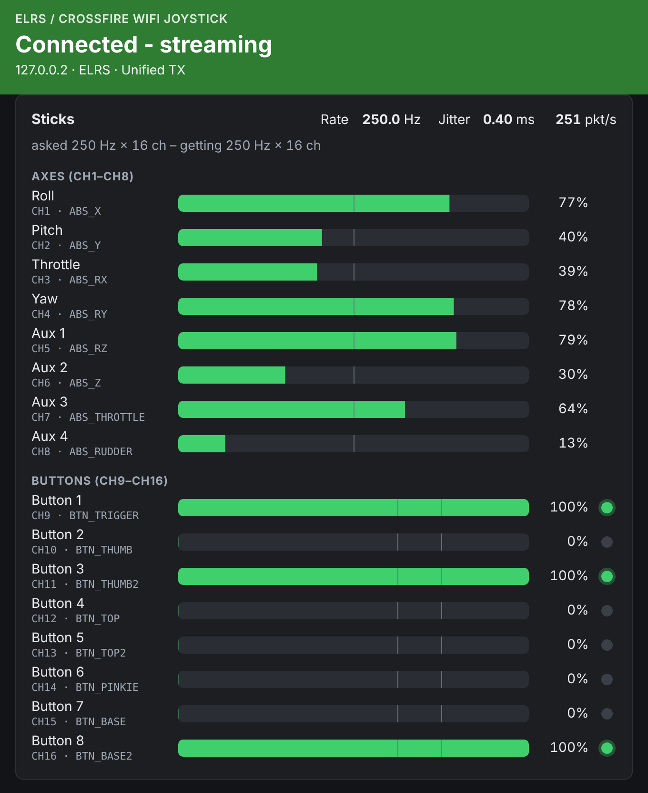

# ExpressLRS / TBS Crossfire WiFi Joystick for Linux

<div align="center">

**Use your ExpressLRS or TBS Crossfire/Tracer radio as a wireless joystick on Linux - with a live terminal UI and web page**

[](https://github.com/juricabi/ELRS-Crossfire-WiFi-Joystick-Linux/actions/workflows/build.yml)
[](#machines)
[](https://www.kernel.org/)
[](LICENSE)



</div>

`elrs-wifi-joystick` turns your **ExpressLRS (ELRS)** *or* **TBS Crossfire / Tracer** TX module's WiFi output into a Linux joystick (via uinput), so you can fly simulators - **wirelessly, no cables** - plus anything on Linux that takes joystick input.

Both radios use the same "WiFi joystick" protocol (the one VelociDrone Mobile speaks), so setup is identical: put the module on your WiFi and run the program. The only difference is the discovery beacon - ELRS announces itself as `ELRS`, Crossfire as `VELOCIDRONE` - and the program handles both automatically.

> **v1.0**: ELRS is asked for **250 Hz × 16 channels** by default, adjustable live from the keys or the web page, and **CH9-CH16 are joystick buttons 1-8**. One static binary per architecture: no dependencies, any distribution.

> 🪟 **On Windows?** [ELRS-Crossfire-WiFi-Joystick-Windows](https://github.com/juricabi/ELRS-Crossfire-WiFi-Joystick-Windows) does the same there (vJoy joystick, a visual app and a CLI), with the same protocol behaviour, defaults and axis order, so bindings carry over. The protocol core (`core/`) is also shared with [sticktime-pi](https://github.com/juricabi/sticktime-pi), the Raspberry Pi FPV simulator.

## ✨ Features

- 🎮 **Virtual joystick** - a uinput joystick: 8 axes in the Windows app's vJoy order, with the module's raw values
- 📡 **ELRS + Crossfire/Tracer** - found automatically by their broadcast, or by a module IP you give
- ⚡ **Adjustable rate & channels** - 250 Hz × 16 channels by default; 10 to 1000 Hz and 4 to 16 channels (see [Rate & channels](#-rate--channels))
- 🔘 **Buttons** - CH9-CH16 are buttons 1-8 (with hysteresis, so a switch never flickers)
- 🖥️ **Terminal UI** - live stick bars, rate and jitter, single-key commands; line commands on stdin; `--daemon` for services
- 🌐 **Web page** - the sticks live, the settings and the log on this machine; it loads nothing from the internet
- 🔒 **Single-source lock** - with two modules on the network, only one drives the joystick
- 🛡️ **Firewall hints** - detects ufw and firewalld and prints the command that lets the stream in
- 💾 **Settings file** - kept up to date by the keys, the stdin commands and the web page
- 📦 **One static binary per architecture** - musl libc, no dependencies, runs on any distribution
- 🧰 **Install script** - the right binary, checked against `SHA256SUMS`, `/dev/uinput` access, an optional systemd user service

## 🚀 Quick Start

1. **Install** it (as root the script also sets up access to `/dev/uinput`; every option and the other ways are in [docs/INSTALL.md](docs/INSTALL.md)):
   ```sh
   curl -fsSLO https://github.com/juricabi/ELRS-Crossfire-WiFi-Joystick-Linux/releases/latest/download/install.sh
   sudo sh install.sh
   ```
2. **Connect** the module to the same WiFi network as this machine (or join this machine to the module's own access point). The module's WiFi is 2.4 GHz only.
3. **Run** `elrs-wifi-joystick`. It finds the module by its broadcast, asks it to stream, and the virtual joystick follows your sticks.
4. **Fly** - pick the joystick named **ELRS Crossfire WiFi Joystick** in the simulator and calibrate it.

> ### 🛑 Crossfire / Tracer: check your firmware first
>
> | Component | Works | Broken |
> |-----------|-------|--------|
> | **Crossfire TX (XF)** | **6.31**, **6.36** | **6.42 public, 6.48 beta, 6.48 public** |
> | **WiFi module** | **v2.17** up to **v3.10** (v2.25.49mb recommended) | **v3.20** |
>
> On a broken version the module streams normally but **never sends stick data** (`no stick data from <ip>`) - every client sees the same dead stream, and nothing on the computer can fix it. Details and source: [firmware compatibility](docs/TROUBLESHOOTING.md#crossfire-firmware-compatibility-important).

### Machines

| Binary | For |
|--------|-----|
| `x86_64` | PCs, laptops, Steam Deck |
| `i686` | old 32-bit PCs (Pentium Pro class CPU or newer) |
| `aarch64` | Raspberry Pi 3/4/5 with a 64-bit OS (or a 32-bit OS on a 64-bit kernel), ARM boards, ARM laptops |
| `armv7` | Raspberry Pi 2/3/4 with a 32-bit OS, most 32-bit ARM boards |
| `armv6` | Raspberry Pi 1 and Zero / Zero W |
| `riscv64` | RISC-V boards (VisionFive, Milk-V, ...) |

Other machines, or changes to the code: [build it from source](docs/INSTALL.md#building-from-source) with a C compiler and the Linux kernel headers (`./build.sh native prog` makes `build/native/elrs-wifi-joystick`). The static release builds, the tests and CI are in [docs/DEVELOPMENT.md](docs/DEVELOPMENT.md), how it works in [docs/DESIGN.md](docs/DESIGN.md).

## 🎮 Usage

- **Terminal**: the status line at the bottom shows the state, the module, the rate and jitter, the request and the sticks. Keys: `s` start/stop, `t` module IP, `r` rate, `c` channels, `p` port, `a` restart the stream, `w` web page address, `h` help, `q` quit.
- **Web page**: <http://127.0.0.1:11000/> - the sticks and buttons live, the settings, start/stop/restart and the log. Changes apply at once and are saved ([its API](docs/WEB_API.md)).

**Command line (optional):** `elrs-wifi-joystick [--module IP] [--rate HZ | --interval US] [--channels N] [--web [ADDR:]PORT] [--daemon]` - e.g. `--module 192.168.1.50` asks that module at once, without waiting for its broadcast. Every option, the stdin commands and the settings file: [docs/USAGE.md](docs/USAGE.md); the systemd user service: [docs/INSTALL.md](docs/INSTALL.md#the-systemd-user-service).

## ⚡ Rate & channels

The program asks the module for an update **rate** and a **channel count** - "the request" ([details](docs/USAGE.md#the-request-rate-and-channels)). Defaults: **250 Hz** (4000 µs) and **16 channels**, the same as the Windows app. Any rate from 10 to 1000 Hz is accepted, and 4 to 16 channels.

| Rate | 1000 Hz | 500 Hz | 333 Hz | **250 Hz** | 200 Hz | 150 Hz | 100 Hz | 50 Hz |
|------|---------|--------|--------|------------|--------|--------|--------|-------|
| Interval (µs) | 1000 | 2000 | 3000 | **4000** | 5000 | 6667 | 10000 | 20000 |

- **ExpressLRS** (3.4.0 and later) streams what it is asked for. A change with the keys `r` / `c` or the web page restarts its stream so that it takes effect ([details](docs/USAGE.md#the-request-rate-and-channels)).
- `--rate` / `--channels` and the settings file only set the next request: if the module still streams from before, press `a` (or restart in the web page). Only a different channel count is fixed by itself.
- **TBS Crossfire / Tracer** ignores both: it always sends 16 channels at about 90 Hz, and a module known as Crossfire by its beacon is never sent `joystick_end`.

## 📋 Channel Mapping

The same order as the Windows app's vJoy device, so bindings carry over:

| Channel | Linux | SDL / `/dev/input/js*` | Windows app (vJoy) |
|---------|-------|------------------------|--------------------|
| CH1 (Roll)     | `ABS_X`        | axis 0 | X axis |
| CH2 (Pitch)    | `ABS_Y`        | axis 1 | Y axis |
| CH3 (Throttle) | `ABS_RX`       | axis 3 | RX axis |
| CH4 (Yaw)      | `ABS_RY`       | axis 4 | RY axis |
| CH5            | `ABS_RZ`       | axis 5 | RZ axis |
| CH6            | `ABS_Z`        | axis 2 | Z axis |
| CH7            | `ABS_THROTTLE` | axis 6 | Slider 0 |
| CH8            | `ABS_RUDDER`   | axis 7 | Slider 1 |
| CH9 - CH16     | `BTN_TRIGGER` ... `BTN_BASE2` | buttons 0-7 | Buttons 1 - 8 |

**Note:** the axes carry the module's raw values (0 to 32767), with no scaling or filtering. A button is pressed from 75 % and released below 62.5 %, so a switch near a threshold never flickers. Channels the module doesn't send, and what happens when it goes quiet: [docs/USAGE.md](docs/USAGE.md#the-joystick).

## 🔧 Troubleshooting

| Issue | Solution |
|-------|----------|
| "no permission to use /dev/uinput" | Run `sudo sh install.sh` once (its udev rule gives the user at the screen access). Over SSH, headless or for a service started at boot: `sudo usermod -aG input $USER` and log in again |
| **Module found and activated, but no data** | A firewall drops the incoming UDP stream: let UDP port 11000 in (`sudo ufw allow 11000/udp`). The program detects ufw and firewalld and prints the right command |
| **Module streams, but "no stick data"** | The radio isn't feeding the module, or the Crossfire firmware is unsupported - see [firmware compatibility](docs/TROUBLESHOOTING.md#crossfire-firmware-compatibility-important) |
| Searching, no module found | Same network? Guest WiFi often isolates clients; VPNs and virtual adapters can get in the way. Or give the IP: `--module 192.168.1.50` |
| Steam shows a gamepad, or axes are missing or doubled | Turn Steam Input off for that game (the game's Properties, Controller) |
| "already running" (exit code 3) | Only one copy may run, e.g. the service: `systemctl --user stop elrs-wifi-joystick` |

More (games, Proton and Wine, two modules, port in use): [docs/TROUBLESHOOTING.md](docs/TROUBLESHOOTING.md).

## ☕ Support

If you like it, you can buy me a coffee:

[](https://ko-fi.com/juricabi)

## 📄 License

This project is licensed under the MIT License - see the [LICENSE](LICENSE) file for details.

The release binaries are statically linked with [musl libc](https://musl.libc.org/) (MIT License, see its [COPYRIGHT](https://git.musl-libc.org/cgit/musl/tree/COPYRIGHT)). Parts of `src/engine.c` and `tests/fake_elrs.py` were first written by the same author for [sticktime-pi](https://github.com/juricabi/sticktime-pi) (GPL-2.0); the author licenses them here under the MIT License.

## 🤝 Contributing

Contributions are welcome! Please read [CONTRIBUTING.md](CONTRIBUTING.md) (the tests to run, and the rules for the shared protocol core) and submit a Pull Request. For major changes, please open an issue first to discuss what you would like to change. Security problems: see [SECURITY.md](SECURITY.md), not a public issue.

### Reporting Issues

When reporting issues, please include:
- Distribution and architecture (`uname -m`)
- Module and firmware version (ELRS, or Crossfire TX and WiFi module)
- How it was started (terminal, `--daemon` or the service) and its options
- Steps to reproduce
- The log (the terminal, the web page, or `journalctl --user -u elrs-wifi-joystick`)

## 🙏 Acknowledgments

- [ExpressLRS](https://github.com/ExpressLRS/ExpressLRS) - The amazing open-source RC link system
- [Linux uinput](https://www.kernel.org/doc/html/latest/input/uinput.html) - Virtual input devices from user space
- [musl](https://musl.libc.org/) - The C library behind the static binaries

---

<div align="center">

**Made with ❤️ for the ExpressLRS community**

[⭐ Star this repository](https://github.com/juricabi/ELRS-Crossfire-WiFi-Joystick-Linux/stargazers) if you find it helpful! · [☕ Buy me a coffee](https://ko-fi.com/juricabi)

</div>
